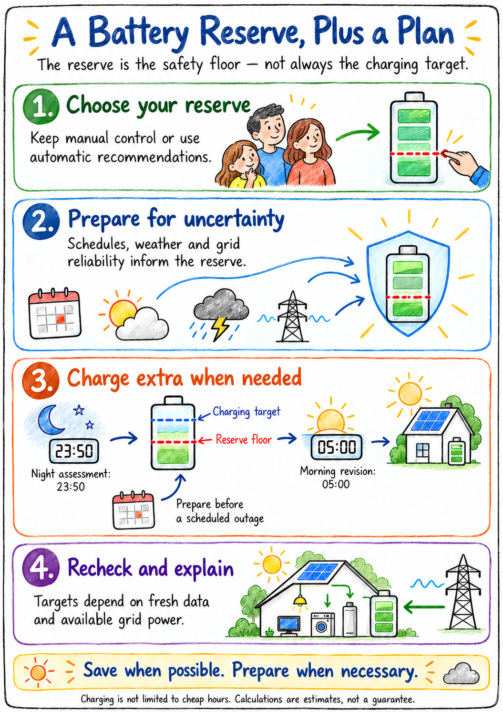

# EnergyHub — solar economy and outage-ready reserve

Make the most of solar energy while preparing for unreliable grid supply.
EnergyHub combines battery and inverter evidence, solar forecasts, weather
warnings, outage schedules and selected household devices through Home Assistant.

## Current public source

This snapshot contains **EnergyHub and Telegram Family Assistant 3.6.37**.
Both apps started on the reference installation. The owner reports several days
of normal observation and has accepted public source promotion. This is not a
new tagged GitHub release. The last
[published release is 2.4.12](https://github.com/serhiykravchenko-sys/EnergyHub/releases/tag/v2.4.12).

| What it does | What the household gets |
| --- | --- |
| Reserve plus separate night/outage targets | A chosen battery floor and extra preparation when evidence supports it |
| Native HA overload protection | Selected plug-group OFF and staged eligible recovery |
| Native outage SOC preservation | Separate four-plug and last-resort fridge policies |
| Supported first-floor heat pump management | Solar/Smart choices, configured night profiles, manual ownership and guarded recovery |
| Telegram briefings and warnings | Morning outlook, grid events, planning and diagnostic explanations |
| Telemetry, BMS/air-sensor evidence and history | Investigate unusual readings without presenting missing data as normal |

## What this product is—and is not

This is a **monolithic reference installation**, implemented by the EH app,
Family companion and HA configuration. It is not yet a universal Core/Custom
product. Verified inverter control is PowMr 10.2M / POW-HVM10.2M PI30MAX; optional
PV2 Modbus is a separate read-only capability. New hardware needs validation.
Entity aliases in the example HA files must be mapped to actual devices.

EnergyHub owns inverter reserve/night/pre-outage charging and HP1 policy.
Native HA owns plug protection. Family messaging does not directly control the
inverter/plugs, but its optional bounded Tuya integration-reload support has
service side effects and is disabled by default in this public snapshot.

Native saved ON intention does not universally preserve a later family OFF.
Switch-request notices are not physical acknowledgements. Fridge commissioning
must consider food/compressor safety; no minimum-OFF timer is promised. Never
map essential, medical or safety-critical loads into a shedding role.

Forecasts, warnings and Telegram depend on external services. Charging may be
needed outside cheap hours. Grid import/cost is estimated, not billing-grade.
No guaranteed saving, uninterrupted supply or exhaustive hardware certification
is claimed. CO alerts in HA do not replace independent certified safety alarms.

## Pictures, setup and evidence

- [Illustrated family guide](docs/Images/family/README.md)
- [Eight technical diagrams](docs/Images/README.md)
- [Installation and upgrade](docs/operations/INSTALLATION.md)
- [Home Assistant integration examples](homeassistant/README.md)
- [Architecture and control boundaries](docs/design/05-System-Architecture.md)
- [Reserve](docs/design/BATTERY_RESERVE_CURRENT.md) and [charging](docs/design/DECISION_ENGINE.md)
- [Family companion](telegram-family-bot/README.md)
- [3.6.37 corrections](RELEASE_NOTES_3.6.37.md) and [validation](docs/validation/RELEASE_3.6.37.md)
- [Documentation map](docs/README.md) and [roadmap](docs/roadmap/06-Roadmap.md)

## Future direction—not shipped capabilities

Configuration-first Core/Custom delivery, a system-aware AI companion through
validated intents, smart EV charging, and later tariff/export/Net Billing
optimization are planned. The deterministic safety boundary remains mandatory.
Telegram Threat Monitor is a separate project and is excluded from this tree.
