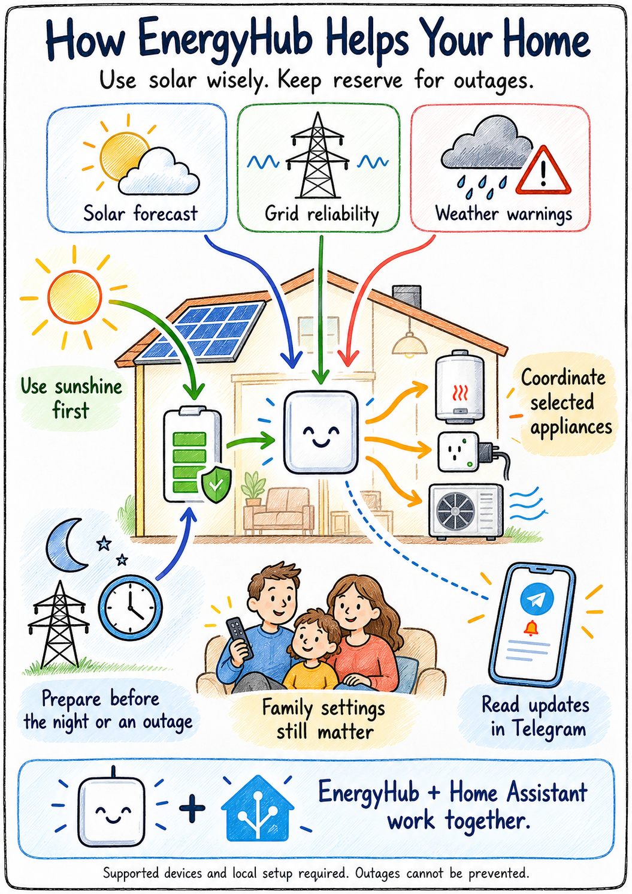
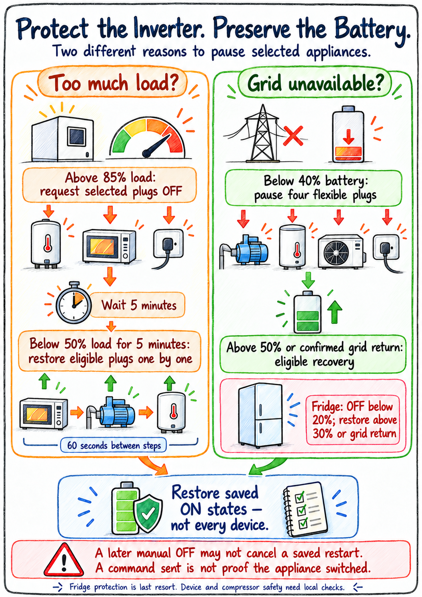
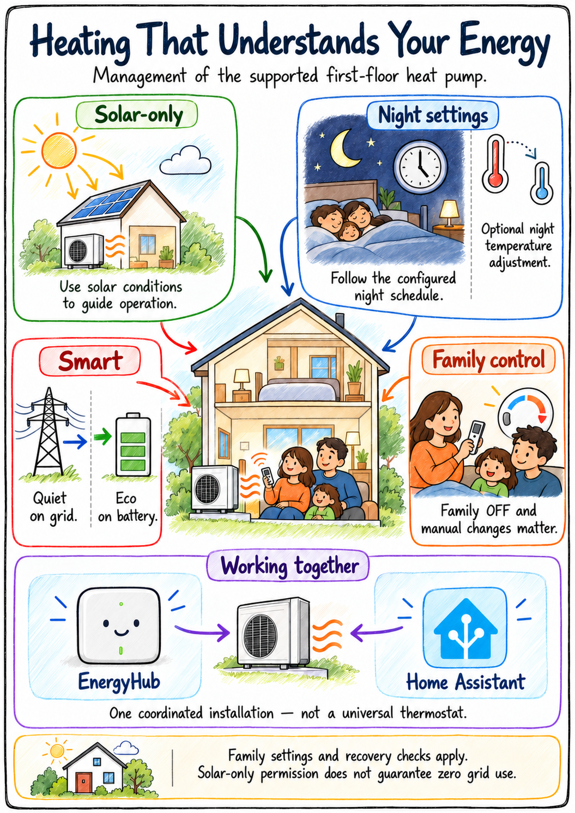

# EnergyHub explained for the family

Illustrated companions to the current technical visual specification. These
explain the installed monolithic system, not a future universal EH Core product.
Language: English, matching the project's working language. Technical rules and
validation limits remain in the [technical index](../README.md).

## Start here: how the home works together

Solar, the battery and grid are coordinated with selected household devices.
Forecasts and warnings help planning; Telegram explains important events.
EnergyHub cannot prevent an external outage or guarantee uninterrupted power.

## A reserve and a charging plan are different

The reserve is a floor. Night deficit and scheduled-outage preparation can need
an additional charging target. Cheap-time savings are a goal, not a promise:
protection can require charging outside cheap hours. Fresh data and an available
grid are prerequisites for claiming grid charging.

## Why appliances may pause

Too much inverter load and a draining battery during an outage are different
triggers. Native HA manages selected plug groups and remembers original states.
The separate fridge rule requests OFF below 20% and permits owned restoration
above 30% or on confirmed grid return. It is last-resort protection, not a
food-safety or compressor-protection guarantee. There is no promised minimum-OFF
timer. A later external OFF may not cancel a saved ON intention inside a native
protection cycle. A request to switch is not physical confirmation.

## How the supported heat pump is managed

Configured policies, profiles and night settings guide the supported first-floor
heat pump. Manual ownership and restoration checks still apply. Solar-only
permission does not certify zero grid use. Native plug protection is separate
from this EH/HA climate-management path.

## About these pictures

The hand-drawn style follows archived project illustrations; their old policy
text was not reused. Built-in image generation produced these raster images,
with the final [prompts](PROMPTS.md) retained for reproducibility and future edits.
The technical SVG/PNG set remains separate and unchanged by illustration work.

The pictures are explanations, not new control settings, live validation or
hardware compatibility guarantees. Future AI, EV/export optimization and the
Core/Custom split are not current capabilities.
