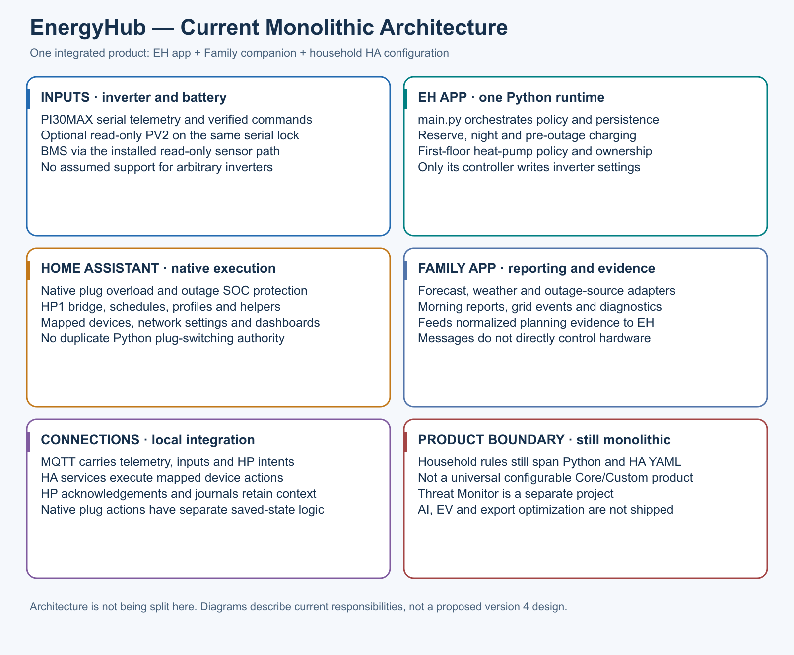

# Current monolithic architecture

One integrated product spans two apps and HA configuration. It is not one
process and is not yet a reusable Core/Custom architecture.

- [EH main loop](../../addon/app/main.py): serialized PI30MAX/PV2 acquisition,
  inverter controller, reserve/night/outage planning, HP1 policy and persistence.
- [Family runtime](../../telegram-family-bot/app/main.py): normalized forecast,
  weather/schedule evidence, reports, diagnostics and notifications. Optional
  isolated Tuya integration reload is bounded and disabled in public defaults.
- [HA package](../../homeassistant/live/config/packages/energyhub_3.yaml):
  settings, climate profiles/schedules and helper state.
- [Native protection](../../homeassistant/live/config/packages/energyhub_native_overload.yaml)
  and [automations](../../homeassistant/live/config/automations.yaml): plug
  overload and outage SOC preservation, snapshots and interlocks; HP1 executor.
- [Network integration](../../homeassistant/live/config/custom_components/energyhub_network/__init__.py):
  supported HP connection evidence and guarded administrator endpoint editing.

MQTT connects telemetry, planning and HP intent/acknowledgement paths. Family
does not provide raw inverter or load-switch control. Fresh source evidence,
persisted ownership and path-specific confirmation govern actions. Native
switch-request notifications are not physical confirmations.

Private device mappings are replaced by examples, not a compatibility claim.
Legacy MQTT/entity/journal names remain where active consumers require them.
