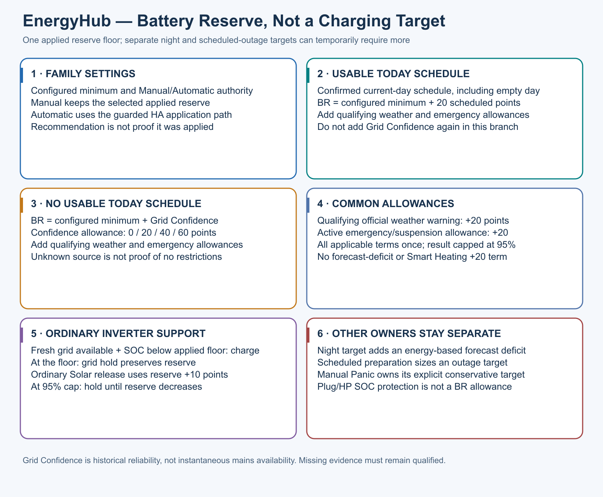

# Current Battery Reserve

The configured minimum and Manual/Automatic authority are separate. A published
recommendation is not proof that HA applied it.

- With a usable current-day schedule (including a confirmed empty day): minimum
  +20 scheduled points + qualifying weather + emergency/suspension allowance.
- Without that schedule: minimum + Grid Confidence allowance (0/20/40/60)
  + qualifying weather + emergency/suspension allowance.
- Qualifying weather and active emergency terms contribute 20 points each once;
  combined recommendation is capped at 95%. Forecast deficit and Smart Heating
  no longer add a reserve term. Missing source evidence is not proof of safety.
- Ordinary fresh-grid reserve support charges below the applied floor, holds
  at the floor and normally releases at reserve +10. The 95% cap remains held
  until reserve decreases. Manual Panic and acquired night/outage owners have
  separate authority; grid absence never proves charging occurred.

See [implementation](../../addon/app/services/weather_buffer.py),
[ordinary inverter support](../../addon/app/services/panic_decision.py),
[separate charging targets](DECISION_ENGINE.md), and
[outage plug preservation](PEAK_LOAD_CONTROL.md).
