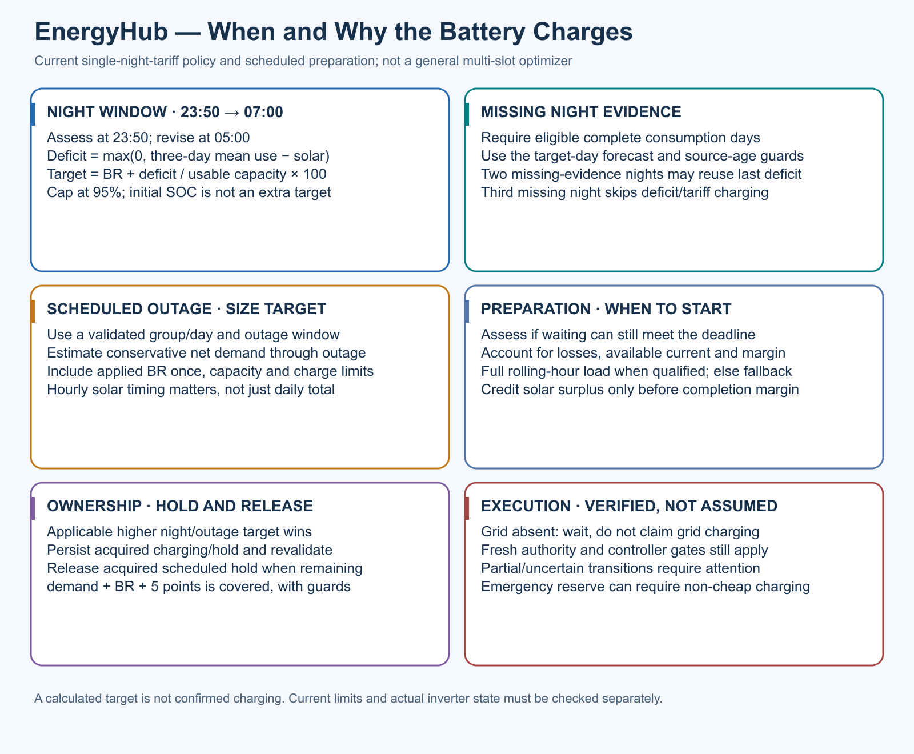

# Night and scheduled-outage charging

[NightCharge](../../addon/app/services/night_charge.py) assesses at 23:50,
revises at 05:00 and expires at 07:00. Target is BR plus the positive difference
between the eligible three-complete-day consumption mean and target-day solar,
converted through configured usable battery capacity and capped at 95%.
Initial SOC is not an extra recharge target. Missing evidence may reuse the last
valid deficit for two missing nights within its age guard; the third skips
deficit/tariff charging. Current controller/authority guards still apply.

[OutagePreparation](../../addon/app/services/outage_preparation.py) sizes
conservative remaining net outage demand plus BR. Solar timing, usable capacity,
current/headroom, losses and a completion margin govern the deadline. A qualified
rolling-hour load replaces configured preparation demand; an incomplete hour
uses the explicit fallback, not an invented zero. Remaining-window release can
occur when fresh evidence covers remaining demand + BR +5 points. Ownership and
restart intent are persisted and revalidated. Applicable higher targets prevail.

This is a single-night-window policy with outage preparation, not dynamic-price
or arbitrary multi-slot optimization. Safety may require non-cheap charging.
Calculated/readiness/charging/hold states have different meanings; a sent mode
request is not a successful inverter transition.
