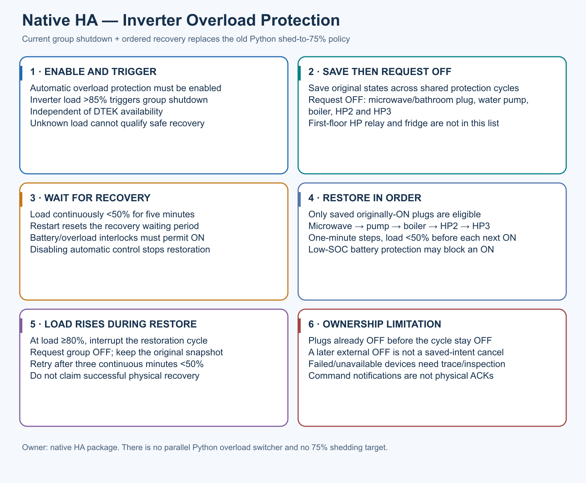
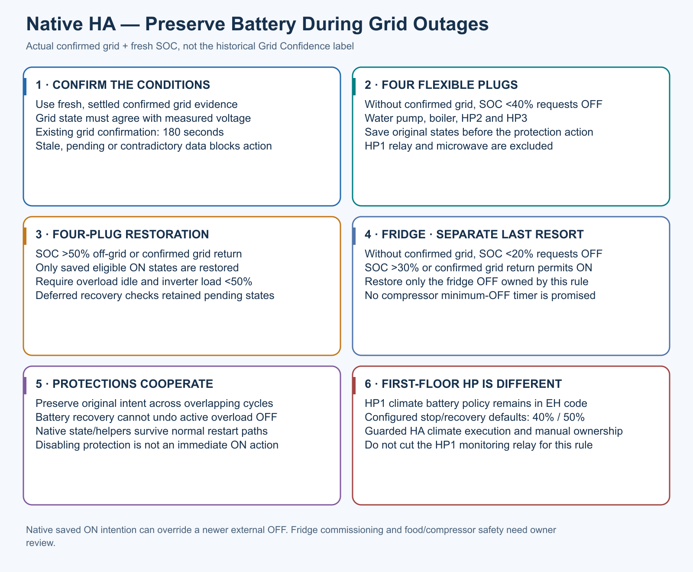

# Native HA plug protection; EH HP1 is separate

Native overload saves original states and requests five configured plug roles
OFF above 85% inverter load, independent of grid. Recovery needs five continuous
minutes below 50%, then eligible originally-ON plugs restore microwave, pump,
boiler, HP2, HP3, with one-minute steps and interlocks. A rise to >=80% during
restore interrupts it, requests group OFF and preserves the snapshot; retry
needs three continuous minutes below 50%. Restart resets the waiting period.
Unknown load cannot qualify recovery. Disabling does not force devices ON.

Native battery preservation requests four flexible plugs OFF below 40% with
confirmed grid absent. Above 50% or confirmed grid return permits eligible
restoration, with overload idle/load below 50% and shared ownership guards.
The separate fridge rule uses below 20%/above 30% or confirmed grid return and
restores only its owned OFF. No compressor minimum-OFF timer is promised.

Saved original ON intention is not universal manual-OFF cancellation: a later
external OFF during a native cycle can be overridden. Requests and notification
delivery are not physical confirmations. Essential/medical/safety loads must
not be mapped here. Commission fridge food/compressor safety locally.

The [native package](../../homeassistant/live/config/packages/energyhub_native_overload.yaml)
and [automation bridge](../../homeassistant/live/config/automations.yaml) own
plug execution. Python retains only [HP1 control](SMART_HEATING_2.4.md) and its
legacy transport/journal compatibility names, not a second plug dispatcher.
