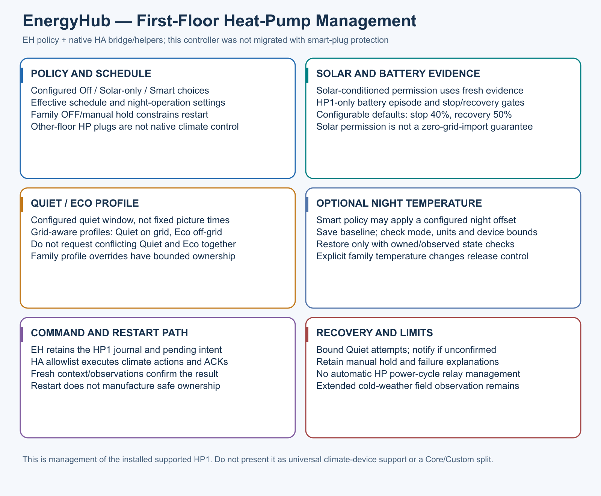

# Current supported HP1 management

The historical filename is retained for existing links; this describes 3.6.37.

EH owns the installed supported first-floor HP battery policy, bounded intents,
acknowledgements and journal. HA owns helper schedules, profile execution and
the mapped climate service boundary. Off/Solar-only/Smart choices and night
settings are configuration-specific. HP1 relay power-cycle management is retired.

Configured HP battery defaults are stop 40%/recovery 50%. Fresh evidence and
manual ownership govern actions. Quiet is grid/night-window aware, Eco is
off-grid; conflicting profiles are not requested together. Optional Smart night
temperature offsets require mode/unit/bounds validation, saved baseline and
observed ownership. Explicit family changes release that control. Quiet retries
are bounded and unconfirmed activation is reported, not invented as successful.

Solar-only permission is not certification of zero grid use. Other-floor HP
plugs are separate native protection roles, not this climate controller.
Extended cold-weather commissioning remains necessary on each installation.
See [HP1 policy](../../addon/app/services/hp1_battery_policy.py),
[controller](../../addon/app/services/peak_load_control.py) and
[HA schedules/profiles](../../homeassistant/live/config/packages/energyhub_3.yaml).
